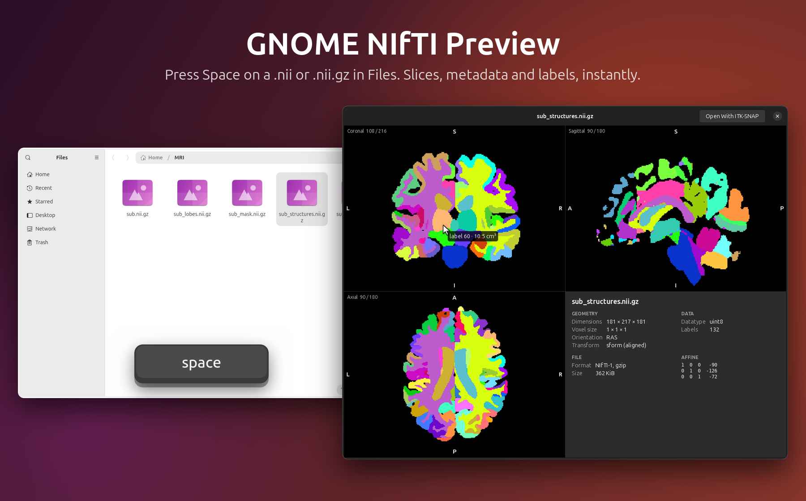
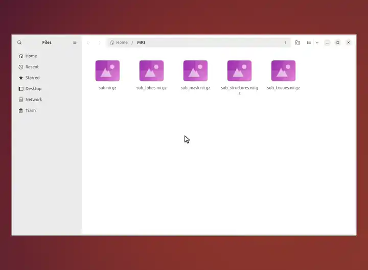
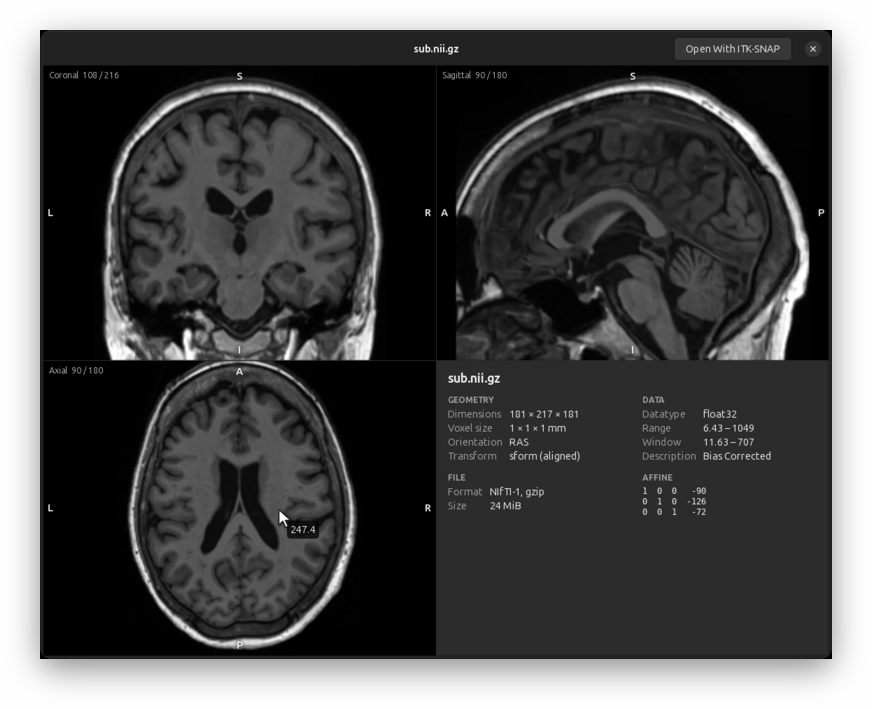
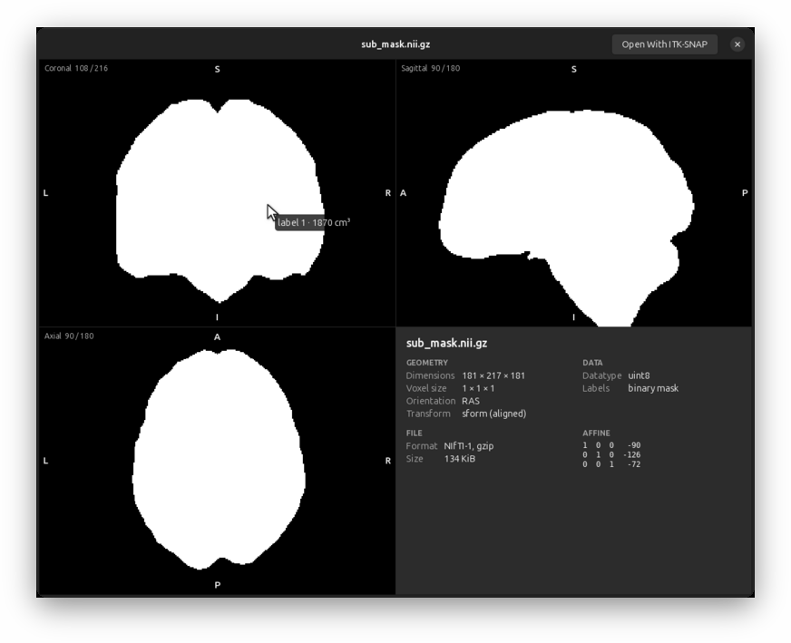

<p align="center">
  
</p>

<p align="center">
  <b>Press Space on a brain MRI in GNOME Files.</b><br>
  Three views, the metadata and the labels of a segmentation, in a fraction of a second.
</p>

## Install

Open a terminal (<kbd>Ctrl</kbd> <kbd>Alt</kbd> <kbd>T</kbd>) and paste:

```sh
wget -qO- https://raw.githubusercontent.com/EloiNavet/gnome-nifti-preview/main/get.sh | bash
```

That's all: nothing to compile, everything stays in your home folder (except, if you
accept, the program GNOME needs for thumbnails, in `/usr/local/bin`). If GNOME's
previewer (GNOME Sushi) is missing, the installer offers to add it.

## Use

Select a medical image in Files and press <kbd>Space</kbd>: NIfTI (`.nii`, `.nii.gz`), FreeSurfer
(`.mgh`, `.mgz`), MRtrix (`.mif`, `.mif.gz`), NRRD (`.nrrd`, `.nhdr`), MetaImage (`.mha`, `.mhd`)
or DICOM (`.dcm`, files without extension, `DICOMDIR`).

| | |
|---|---|
| <kbd>Scroll</kbd> | Move through the slices |
| <kbd>Shift</kbd> + <kbd>Scroll</kbd>, <kbd>,</kbd> <kbd>.</kbd>, <kbd>Home</kbd> <kbd>End</kbd> | 4D: move through the volumes (or drag the slider) |
| <kbd>[</kbd> <kbd>]</kbd> | DICOM: previous / next series of the same exam (or pick it in the menu) |
| Hover | The value under the pointer; on a segmentation, the label and its volume |
| <kbd>Click</kbd> | Navigate: the other views follow |
| <kbd>←</kbd> <kbd>→</kbd> | Previous / next file |
| Right-drag, double right-click | Adjust the brightness and contrast, back to automatic |
| <kbd>O</kbd> | Neurological, radiological or stored orientation |
| <kbd>L</kbd> | Colours (segmentations, RGB images) or grayscale |
| <kbd>Space</kbd> | Close |

<p align="center">
  
</p>

## What you get

<p align="center">
  
  
</p>

- **Instant.** The slices of a 1 mm T1 appear in about 0.2 s, even compressed.
- **The right way up.** Every view is labelled R/L, A/P, S/I from the file's own orientation; tilted acquisitions are resampled upright.
- **Segmentations.** Detected automatically and coloured; FreeSurfer parcellations (aseg, aparc, a2009s, wmparc) get FreeSurfer's colours and names. Point at a structure to see its label, name and volume in cm³; the panel lists them all.
- **The essentials at a glance.** Dimensions, voxel size, orientation, datatype, value range; the rest on demand.
- **fMRI and diffusion too.** A slider scrubs through the volumes of a 4D series, and the time course of the voxel under the pointer is drawn below it.
- **DICOM.** Space on one file of a series shows the whole series, on that slice: slices sorted in space, volumes in time, Siemens mosaics and enhanced multi-frame files rebuilt. Every common compression (JPEG, JPEG-LS, JPEG 2000, HTJ2K, RLE, deflate), colour and palettes, the window the file gives, a menu of the other series of the exam or of a DICOMDIR. Reports, radiotherapy plans and structure sets, and ECGs show what they hold. Patient details stay hidden unless you ask for them.
- **Files on servers.** Over sftp://, smb://, NFS or sshfs, the image is read in the background with its progress, and the preview asks before reading a large one.
- **Thumbnails in Files.** Each image shows a slice as its icon (a segmentation in colour, a spectrum for spectroscopy); the installer asks before it copies the one program this needs to `/usr/local/bin`.
- **Spectroscopy.** NIfTI-MRS files show their spectrum in ppm, all coils and averages combined; on spectroscopic imaging, click a voxel to see its spectrum.
- **One click to your viewer.** With ITK-SNAP installed (or FSLeyes, MRIcroGL, MRIcron), the preview's *Open With ITK-SNAP* opens the file in it. Without one, the button says what to install, rather than letting Files extract the `.nii.gz`.
- **Private.** Nothing leaves your computer: the preview uploads nothing and saves no copy of your images (GNOME keeps its usual caches).

Works with GNOME Files on Ubuntu 24.04, 26.04 and 26.10 (GNOME Sushi 46 to 51) and other
GNOME distributions, for NIfTI-1 and NIfTI-2, FreeSurfer MGH/MGZ, MRtrix, NRRD, MetaImage and DICOM files.
Prefer other defaults (radiological view, a colour palette, other panel rows, less memory…)? Open **NIfTI Preview**
in the applications menu, or the gear button of a preview: see [settings](docs/SETTINGS.md).

To remove it: `~/.local/share/gnome-nifti-preview/uninstall.sh`

## In a terminal

The same images over SSH, on a cluster or in a container, without GNOME: `nitty`.

```sh
wget -qO- https://raw.githubusercontent.com/EloiNavet/gnome-nifti-preview/main/get.sh | bash -s -- --terminal
```

It installs one static program in `~/.local/bin` (or `/usr/local/bin` as root), and nothing
else; with Rust and a C compiler (`build-essential`: two of the image decoders are in C),
`cargo install --locked --git https://github.com/EloiNavet/gnome-nifti-preview nitty` builds it
instead. Every format of the preview is read, DICOM series included.

```sh
nitty T1w.nii.gz            # the viewer (q quits, ? lists the keys)
nitty -p T1w.nii.gz         # a quick look: the three views, printed, and back to the prompt
nitty -p --info --legend aparc+aseg.mgz    # with the metadata and the labels' names and volumes
```

Terminals that draw images (Kitty, Ghostty, WezTerm, iTerm2, Konsole, foot, xterm with Sixel...) get
real pictures, through whichever protocol they say they have (Kitty's, iTerm2's or Sixel); the others
(GNOME Terminal, Ptyxis, the Linux console) get coloured half-blocks, and so does tmux unless it was
built to draw Sixel. A dumb terminal (`TERM=dumb`) gets characters by brightness; a pipe or a file
gets the half-blocks in colour, and `--protocol ascii` plain text. See
[compatibility](docs/COMPATIBILITY.md#terminal-viewer-nitty).

| | |
|---|---|
| <kbd>←</kbd> <kbd>→</kbd> <kbd>↑</kbd> <kbd>↓</kbd>, click | Move the cursor in the active view (<kbd>Shift</kbd>: 10 voxels) |
| <kbd>PgUp</kbd> <kbd>PgDn</kbd>, <kbd>Z</kbd> <kbd>X</kbd>, wheel | Slices of the active view |
| <kbd>V</kbd>, <kbd>1</kbd> <kbd>2</kbd> <kbd>3</kbd> <kbd>0</kbd> | Next view; one view alone, all three |
| <kbd>O</kbd>, <kbd>L</kbd>, <kbd>P</kbd> | Orientation; labels or grayscale; palette |
| <kbd>W</kbd> <kbd>B</kbd> <kbd>R</kbd> | Window narrower and darker (<kbd>Shift</kbd>: wider, brighter); automatic again |
| <kbd>,</kbd> <kbd>.</kbd>, <kbd>[</kbd> <kbd>]</kbd>, <kbd>N</kbd> (<kbd>Shift</kbd>) | 4D volumes, DICOM series, next (previous) file |
| <kbd>Tab</kbd> | Metadata, labels and their volumes, time course of the voxel |

`nitty --help` lists the options (`--protocol`, `--colors`, `--view`, `--at`, `--window`...). Ideas
were taken from [niicat](https://github.com/MIC-DKFZ/niicat) (the quick look) and
[headjack](https://github.com/childmindresearch/headjack) (the viewer in half blocks).

## More

[Troubleshooting](docs/TROUBLESHOOTING.md) ·
[Build from source](docs/DEVELOPMENT.md) ·
[How it works](docs/ARCHITECTURE.md) ·
[Display conventions](docs/DISPLAY_CONVENTIONS.md) ·
[Compatibility](docs/COMPATIBILITY.md) ·
[Benchmarks](docs/BENCHMARKS.md) ·
[Security](docs/SECURITY.md)

On macOS or Windows? Have a look at [MIQ](https://github.com/marcoduering/MIQ) and
[MIQ-Win](https://github.com/marcoduering/MIQ-Win) by Marco Düring, which bring the same
Space-bar preview of medical images to Finder and File Explorer and inspired this project.

GPL-2.0-or-later; the screenshots and videos (`docs/images`, `site/assets`) are CC BY 4.0.
A convenience tool for research, **not a medical device**.
